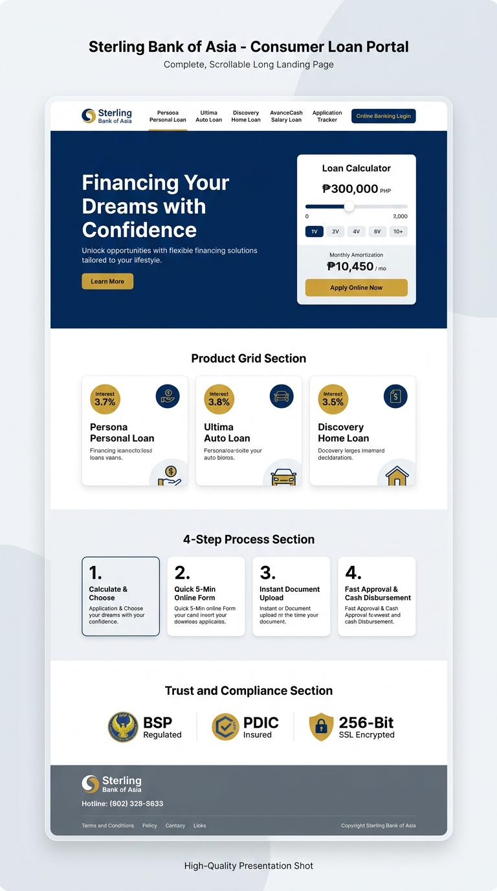

# Sterling Bank of Asia – Digital Consumer Loan Portal

A modern, high-performance, banking-grade Consumer Loan web application for **Sterling Bank of Asia**, engineered with **Next.js 15 (App Router)**, **React 19**, **TypeScript**, and **Tailwind CSS**.



---

## 🌟 Key Features

1. **Interactive Loan Simulator:**
   - Real-time loan amount slider (PHP ₱30,000 to ₱15,000,000) and tenor selection.
   - Dynamic monthly amortization calculation using Philippine banking standard Equal Monthly Installment (EMI) formulas.
   - Interactive modal displaying the complete month-by-month principal and interest amortization breakdown schedule.

2. **Retail Loan Suite:**
   - **Persona Personal Loan:** Unsecured cash loan up to ₱1M with 12 to 36 months flexible terms.
   - **Ultima Auto Loan:** Financing for brand new and pre-owned vehicles up to 80% vehicle appraisal value.
   - **Discovery Home Loan:** Mortgage loans up to ₱25M with up to 25 years tenor.
   - **AvanceCash Salary Loan:** Short-term payroll advance financing.

3. **5-Step Digital Onboarding Wizard (`QuickApplyModal`):**
   - Step 1: Personal & Government ID (PhilSys National ID, UMID, TIN).
   - Step 2: Residence & Home Ownership tenure verification.
   - Step 3: Employment, Employer details, and Gross Monthly Income validation.
   - Step 4: Digital KYC Document Upload (Magic byte validated, presigned quarantine).
   - Step 5: Data Privacy Act (RA 10173) consent & credit bureau authorization.
   - Generates unique Application Reference Number (e.g. `SBA-LN-202611-98421`).

4. **Self-Service Application Status Tracker (`#tracker`):**
   - Real-time progress pipeline: *Submitted → Document Review → Credit Underwriting → Approved → Disbursed*.
   - Officer remarks & timestamped audit milestones.

5. **Banking Security & BSP Compliance:**
   - Aligned with Bangko Sentral ng Pilipinas (BSP) Circulars 808 & 982.
   - Strict Content Security Policy (CSP) nonce generation.
   - HSTS preload and anti-clickjacking headers (`X-Frame-Options: DENY`).
   - Field-Level Encryption (FLE) for sensitive PII.

---

## 🚀 Running the Project Locally

```bash
# 1. Install dependencies
npm install

# 2. Run local development server
npm run dev

# 3. Open browser
http://localhost:3000
```

---

## ☁️ Deploying to Cloudflare Pages & GitHub

1. **Push to GitHub:**
   ```bash
   git init
   git add .
   git commit -m "feat: complete Sterling Bank Consumer Loan portal in Next.js 15"
   git remote add origin https://github.com/<your-username>/sterling-bank-loans.git
   git branch -M main
   git push -u origin main
   ```

2. **Connect to Cloudflare Pages:**
   - Go to [dash.cloudflare.com](https://dash.cloudflare.com) > **Compute (Workers & Pages)** > **Create Application** > **Pages** > **Connect to Git**.
   - Select your GitHub repository.
   - Build Preset: `Next.js`
   - Build command: `npx @cloudflare/next-on-pages` (or standard `npm run build`)
   - Output directory: `.vercel/output/static` (or `.next`)
   - Click **Save and Deploy**!
