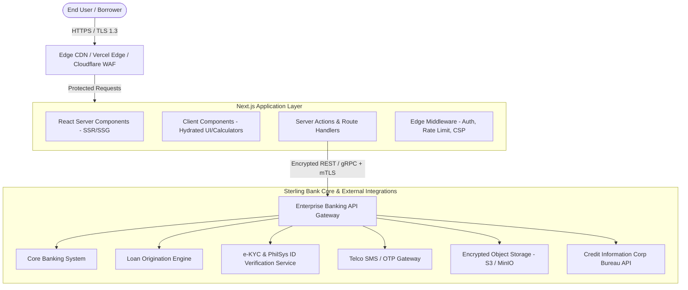
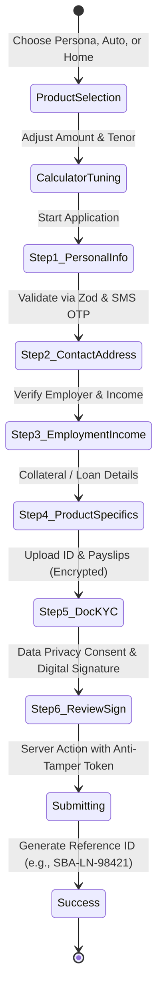

# System Architecture & UI/UX Technical Design Document
## Project: Sterling Bank of Asia – Digital Consumer Loan Platform
**Target Stack:** Next.js 15+ (App Router), React 19, TypeScript, Tailwind CSS, Radix UI / Shadcn, Zustand, Zod, React Hook Form  
**File Location:** `d:\Consumer Loan\design.md`  

---

## 1. System Architecture Overview

The system is designed following the **Backend-for-Frontend (BFF)** pattern utilizing Next.js App Router. This decouples the client-facing presentation layer from legacy core banking systems (like Finacle or Silverlake) while enforcing strict server-side encryption, API secret protection, and session security.



---

## 2. Directory Structure (Next.js App Router)

```text
d:\Consumer Loan\
├── app/
│   ├── (marketing)/
│   │   ├── layout.tsx                     # Public layout with Global Header & Footer
│   │   ├── page.tsx                       # Consumer Loans Landing Hub
│   │   ├── personal-loan/
│   │   │   └── page.tsx                   # Persona Personal Loan Details & Calculator
│   │   ├── auto-loan/
│   │   │   └── page.tsx                   # Ultima Auto Loan Details & Vehicle Selector
│   │   ├── home-loan/
│   │   │   └── page.tsx                   # Discovery Home Loan Details & Property Estimator
│   │   └── salary-loan/
│   │       └── page.tsx                   # AvanceCash Salary Loan Information
│   ├── (funnel)/
│   │   ├── apply/
│   │   │   ├── layout.tsx                 # Focused application layout (Distraction-free)
│   │   │   ├── page.tsx                   # Product Selection & Pre-eligibility
│   │   │   ├── [loanType]/
│   │   │   │   ├── step-1-personal/       # Personal information & identity
│   │   │   │   ├── step-2-residence/      # Residential & Contact details
│   │   │   │   ├── step-3-employment/     # Income & Employment verification
│   │   │   │   ├── step-4-loan-details/   # Specific loan collateral/purpose parameters
│   │   │   │   ├── step-5-documents/      # Drag & Drop KYC Document Uploader
│   │   │   │   └── step-6-review/         # Review summary & Digital E-sign
│   │   │   └── success/
│   │   │       └── page.tsx               # Submission confirmation & Ref Number
│   ├── tracker/
│   │   ├── page.tsx                       # Public status tracker search
│   │   └── [refNumber]/
│   │       └── page.tsx                   # Live timeline & status tracking dashboard
│   ├── api/
│   │   ├── calculator/
│   │   │   └── route.ts                   # Server-side validation of amortizations
│   │   ├── otp/
│   │   │   ├── send/route.ts              # Send SMS OTP
│   │   │   └── verify/route.ts            # Verify SMS OTP
│   │   ├── upload/
│   │   │   └── route.ts                   # Presigned URL generation for secure KYC uploads
│   │   └── loans/
│   │       ├── submit/route.ts            # Encrypted submission to Loan Origination
│   │       └── status/[ref]/route.ts      # Application tracking endpoint
│   ├── globals.css                        # Tailwind CSS imports & theme definitions
│   └── layout.tsx                         # Root layout with fonts, metadata, providers
├── components/
│   ├── ui/                                # Atomic primitives (Button, Input, Slider, Modal, Badge)
│   │   ├── button.tsx
│   │   ├── input.tsx
│   │   ├── slider.tsx
│   │   ├── select.tsx
│   │   ├── card.tsx
│   │   ├── dialog.tsx
│   │   └── stepper.tsx
│   ├── calculators/                       # Specialized Loan Calculation Modules
│   │   ├── LoanCalculatorCard.tsx
│   │   ├── AmortizationChart.tsx
│   │   └── ScheduleTableModal.tsx
│   ├── funnel/                            # Application Form Steps
│   │   ├── FormStepHeader.tsx
│   │   ├── PersonalInfoStep.tsx
│   │   ├── EmploymentStep.tsx
│   │   ├── DocumentUploadDropzone.tsx
│   │   └── ConsentSignatureBox.tsx
│   ├── layout/                            # Shared layout components
│   │   ├── Navbar.tsx
│   │   ├── TopNoticeBar.tsx
│   │   ├── Footer.tsx
│   │   └── TrustBadges.tsx
│   └── tracking/                          # Status Tracking Components
│       ├── TimelineStepper.tsx
│       └── StatusBadge.tsx
├── lib/
│   ├── constants/
│   │   ├── bank-rates.ts                  # Standard rates, tenure steps, product limits
│   │   └── nav-links.ts
│   ├── formulas/
│   │   └── amortization.ts                # Financial calculation formulas (PMT, EIR, Fees)
│   ├── validations/
│   │   ├── loan-application.schema.ts     # Zod schemas for all form steps
│   │   └── tracker.schema.ts
│   ├── encryption/
│   │   └── crypto.ts                      # Client-to-server payload encryption utilities
│   └── api-client.ts                      # Typed fetch wrapper with CSRF injection
├── store/
│   ├── useLoanCalculatorStore.ts          # Zustand store for live calculator sliders
│   └── useApplicationFormStore.ts         # Persistent multi-step draft store
└── types/
    ├── loan.d.ts                          # Domain models for loan applications
    └── user.d.ts
```

---

## 3. Brand & Visual Design System

### 3.1 Color Palette
The visual identity directly reflects Sterling Bank of Asia's established corporate trust while delivering modern fintech sophistication:

```css
:root {
  /* Sterling Bank Corporate Colors */
  --sba-primary: #002D62;          /* Royal Sterling Navy - Primary Trust Color */
  --sba-primary-light: #0A438A;    /* Navy Highlight */
  --sba-secondary: #C89D35;        /* Sovereign Gold - Premium accents, badges, CTAs */
  --sba-secondary-hover: #B28B2B;  /* Deeper Gold for interactive hover states */
  --sba-accent: #00875A;           /* Approved / Success Green */
  --sba-destructive: #D9381E;      /* Warning / Error Red */
  
  /* Neutral Palette */
  --sba-bg-light: #F8FAFC;         /* Soft canvas background */
  --sba-surface: #FFFFFF;          /* Pure Card White */
  --sba-border: #E2E8F0;           /* Clean dividers */
  --sba-text-main: #0F172A;        /* Slate 900 for razor-sharp typography */
  --sba-text-muted: #64748B;       /* Slate 500 for secondary descriptions */
}
```

### 3.2 Typography & Elevation
- **Display & Headings:** `Plus Jakarta Sans`, font weights 600, 700, 800.
- **Body & Data Displays:** `Inter`, font weights 400, 500, 600 with tabular figures (`font-variant-numeric: tabular-nums;`) for monetary values.
- **Elevation Hierarchy:**
  - Standard Card: `box-shadow: 0 1px 3px 0 rgb(0 0 0 / 0.05), 0 1px 2px -1px rgb(0 0 0 / 0.05);`
  - Floating Calculator / Dropdown: `box-shadow: 0 10px 15px -3px rgb(0 0 0 / 0.08);`
  - Active Step Card: `ring-2 ring-[#C89D35] ring-offset-2`

---

## 4. Financial Calculation Engine Specification

The formula for Equal Monthly Installment (EMI) based on the Philippine banking standard formula:

$$EMI = \frac{P \times r \times (1 + r)^n}{(1 + r)^n - 1}$$

Where:
- $P$ = Net Principal Financed (Loan Amount minus upfront fees if net proceeds calculation is opted).
- $r$ = Monthly Interest Rate (Annual Factor Rate or Nominal Rate $\div 12$).
- $n$ = Tenor in Months.

### TypeScript Implementation (`lib/formulas/amortization.ts`):
```typescript
export interface CalculationResult {
  monthlyAmortization: number;
  totalRepayment: number;
  totalInterest: number;
  effectiveInterestRate: number;
  amortizationSchedule: AmortizationRow[];
}

export interface AmortizationRow {
  month: number;
  beginningBalance: number;
  payment: number;
  principal: number;
  interest: number;
  endingBalance: number;
}

export function calculateLoan(
  principal: number,
  annualRatePct: number,
  tenorMonths: number
): CalculationResult {
  const monthlyRate = annualRatePct / 100 / 12;
  const factor = Math.pow(1 + monthlyRate, tenorMonths);
  const monthlyAmortization = (principal * monthlyRate * factor) / (factor - 1);
  const totalRepayment = monthlyAmortization * tenorMonths;
  const totalInterest = totalRepayment - principal;

  const schedule: AmortizationRow[] = [];
  let currentBalance = principal;

  for (let m = 1; m <= tenorMonths; m++) {
    const interestComponent = currentBalance * monthlyRate;
    const principalComponent = monthlyAmortization - interestComponent;
    const endingBalance = Math.max(0, currentBalance - principalComponent);

    schedule.push({
      month: m,
      beginningBalance: currentBalance,
      payment: monthlyAmortization,
      principal: principalComponent,
      interest: interestComponent,
      endingBalance,
    });

    currentBalance = endingBalance;
  }

  return {
    monthlyAmortization: Math.round(monthlyAmortization * 100) / 100,
    totalRepayment: Math.round(totalRepayment * 100) / 100,
    totalInterest: Math.round(totalInterest * 100) / 100,
    effectiveInterestRate: annualRatePct,
    amortizationSchedule: schedule,
  };
}
```

---

## 5. Multi-Step Onboarding Funnel UX Flow



### Key UX Safeguards:
1. **Auto-Save Drafts in Session Storage:** Prevents customer frustration if a session drops. Sensitive PII fields are encrypted in `sessionStorage` with a temporary session key.
2. **Inline Field Validation:** Validates Philippine Mobile numbers (`+63 9xx xxx xxxx`), TIN (9 digits), SSS (10 digits) instantly using Zod schemas.
3. **Instant KYC Image Optimization:** High-resolution photos from smartphone cameras (5MB+) are compressed client-side via Canvas API to < 800KB before encrypted transmission.

---

## 6. Component Architecture & State Management

### 6.1 Zustand Store Architecture (`store/useApplicationFormStore.ts`)
The application wizard manages state across 6 distinct steps without re-rendering unnecessary branches:

```typescript
import { create } from 'zustand';
import { persist, createJSONStorage } from 'zustand/middleware';

export interface ApplicationState {
  currentStep: number;
  loanType: 'persona' | 'auto' | 'home' | 'salary';
  loanParameters: {
    amount: number;
    tenorMonths: number;
    purpose?: string;
  };
  personalData: Record<string, any>;
  contactData: Record<string, any>;
  employmentData: Record<string, any>;
  uploadedDocuments: Array<{ id: string; type: string; s3Key: string; name: string }>;
  isDraftSaved: boolean;
  
  // Actions
  setStep: (step: number) => void;
  updateLoanParameters: (params: Partial<ApplicationState['loanParameters']>) => void;
  updateStepData: (stepKey: string, data: Record<string, any>) => void;
  addDocument: (doc: { id: string; type: string; s3Key: string; name: string }) => void;
  resetForm: () => void;
}
```

---

## 7. Performance & Optimization Strategy

1. **Static Rendering for Product Information Pages:** High SEO ranking for search terms like *"Sterling Bank Persona Loan"*, *"Auto Loan calculator Philippines"*.
2. **Next.js Dynamic Imports (`next/dynamic`):** The heavy Amortization Schedule Chart (Chart.js / Recharts) and E-signature Canvas are lazy-loaded only when the user requests the detailed breakdown or reaches Step 6.
3. **Image Optimization (`next/image`):** AVIF/WebP auto-formatting with strict size attributes and blur-up placeholders.
4. **Edge CDN Caching:** Static loan parameter rules and branch location lists cached at the CDN edge with 24-hour revalidation.
