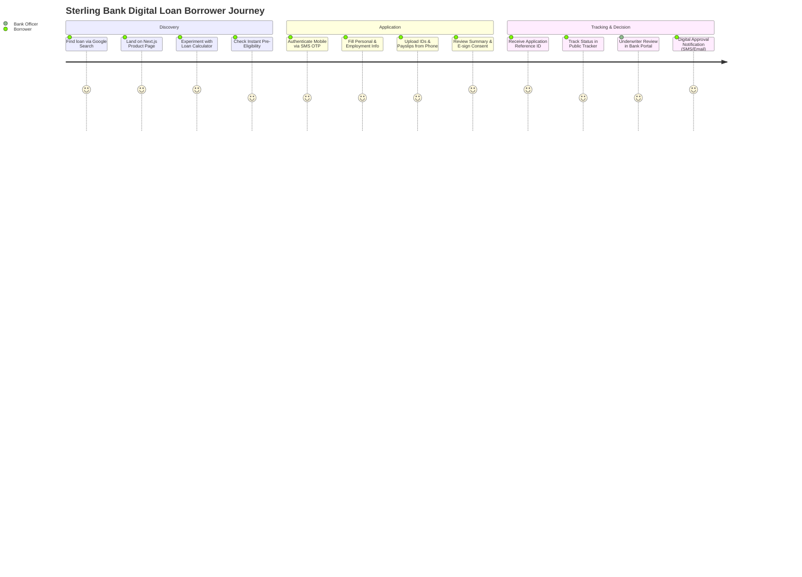
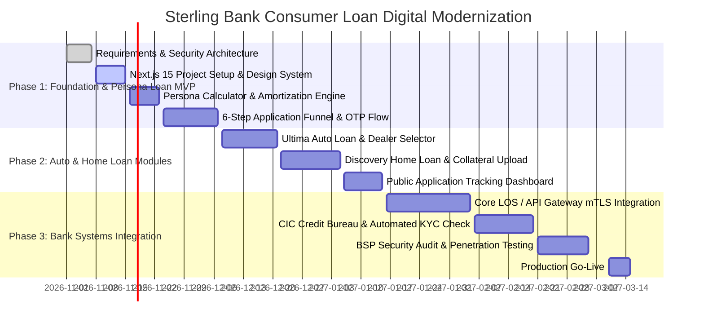

# Product Requirements Document (PRD)
## Project: Sterling Bank of Asia – Next-Gen Consumer Loan Digital Onboarding
**Document Type:** Product Management Document (PMD / PRD)  
**Product Owner:** Digital Banking & Retail Lending Group  
**Target Reference:** [sterlingbankasia.com](https://www.sterlingbankasia.com/)  
**Document Status:** Ready for Engineering  
**Version:** 1.0  

---

## 1. Product Vision & Strategic Rationale

### 1.1 Vision Statement
To transform Sterling Bank of Asia's retail lending from a traditional, branch-dependent, paper-intensive experience into the Philippines' most agile, customer-centric, and secure digital loan acquisition platform.

### 1.2 The Opportunity
The existing legacy web portal on Drupal relies on static information display and downloadable PDF application forms. Prospective borrowers must print, fill out by hand, scan, or bring physical papers to physical branches. 
By deploying an intelligent, interactive Next.js platform:
- **Application Drop-off Rate** can be reduced by 65%.
- **Turnaround Time (TAT)** for credit decisioning can decrease from 7 business days to under 48 hours.
- Customer engagement is captured at the moment of intent via instant loan simulation.

---

## 2. User Personas

### Persona A: "The Forward-Thinking Professional"
* **Name:** Mark, 29 years old
* **Role:** Senior Software Engineer in BGC, Taguig
* **Income:** ₱85,000 / month
* **Goal:** Needs a ₱250,000 **Persona Personal Loan** for home workspace upgrades and tech investments without visiting a bank branch during office hours.
* **Pain Point:** Frustrated by paper forms, lack of mobile-responsive sites, and opaque interest rate tables.

### Persona B: "The Growing Family"
* **Name:** Maria, 36 years old
* **Role:** Marketing Director & Husband (Dual Income)
* **Combined Income:** ₱160,000 / month
* **Goal:** Purchasing an SUV via **Ultima Auto Loan** (₱1.4M loan value, 20% down, 60-month tenor).
* **Pain Point:** Unclear monthly amortizations across different dealer quotes; wants to simulate options transparently on her phone before committing.

### Persona C: "The First-Time Home Buyer"
* **Name:** Juan, 42 years old
* **Role:** Licensed Accountant & Business Consultant
* **Income:** ₱200,000 / month
* **Goal:** Acquiring a condominium unit in Ortigas via **Discovery Home Loan**.
* **Pain Point:** Complex documentation requirements; needs clear document checklists and progress status updates.

---

## 3. Customer Journey Map

---

## 4. Feature Epics & User Stories

### Epic 1: High-Performance Loan Discovery & Simulation
* **US-1.1:** *As a prospective borrower, I want to slide loan amount and tenor controls so that I can immediately view my monthly payment, total interest, and effective interest rate.*
  - **Acceptance Criteria:**
    - Slider updates result within < 16ms (60 FPS responsiveness).
    - Amortization calculation precisely adheres to BSP truth-in-lending disclosure rules.
    - Currency is formatted with the Philippine Peso symbol (`₱`), thousands separators, and 2 decimal points.
* **US-1.2:** *As a borrower, I want to expand an interactive Amortization Schedule table so that I can see the principal-to-interest breakdown for each month.*
  - **Acceptance Criteria:**
    - Modal or accordion opens without page reload.
    - Option to export schedule as a printable PDF or CSV.

### Epic 2: Frictionless Multi-Step Application Funnel
* **US-2.1:** *As an applicant, I want the system to validate my personal and financial inputs inline so that I can correct errors before submitting.*
  - **Acceptance Criteria:**
    - Zod schemas validate phone numbers (`^(\+639|09)\d{9}$`), emails, and ID numbers.
    - Clear, human-readable error messages appear directly below invalid inputs.
* **US-2.2:** *As an applicant, I want my progress automatically saved in my current browser session so that I do not lose entered data if accidentally refreshing or switching tabs.*
  - **Acceptance Criteria:**
    - State is persisted in encrypted `sessionStorage`.
    - User can navigate freely back and forth across steps without losing form state.
* **US-2.3:** *As an applicant, I want to take a photo of my ID and payslips with my smartphone and drag-and-drop them seamlessly.*
  - **Acceptance Criteria:**
    - Supports JPG, PNG, and PDF formats up to 10MB each.
    - Client-side image compression converts photos to optimized WebP/JPEG under 1MB.
    - Visual upload progress bar and thumbnail preview with delete/re-upload capability.

### Epic 3: Identity Verification & Security Handshake
* **US-3.1:** *As a bank risk officer, I require applicant mobile numbers to be verified via a 6-digit OTP before submission.*
  - **Acceptance Criteria:**
    - OTP valid for 5 minutes with a 60-second cooldown timer before resend.
    - Maximum 3 incorrect attempts before temporary 15-minute lock.
* **US-3.2:** *As a compliance officer, I require explicit data privacy consent conforming to Republic Act 10173 before any submission.*
  - **Acceptance Criteria:**
    - Dedicated consent step with explicit consent checkboxes and digital e-signature pad.
    - Timestamp, IP address, and browser user-agent cryptographically linked to the submission record.

### Epic 4: Real-time Application Tracking
* **US-4.1:** *As an applicant, I want to check the status of my loan application using my Reference ID so that I know what stage my application is in.*
  - **Acceptance Criteria:**
    - Clean lookup page at `/tracker`.
    - Requires Reference ID (e.g., `SBA-LN-202611-98421`) and the last 4 digits of the registered mobile number for authentication.
    - Displays visual timeline: *Submitted → Document Review → Credit Underwriting → Approved → Disbursed*.

---

## 5. Success Metrics & Key Performance Indicators (KPIs)

| Metric | Baseline (Legacy Drupal Portal) | Target (Next.js Application) | Measurement Tool |
| :--- | :--- | :--- | :--- |
| **Application Completion Rate** | 12% (due to PDF barrier) | **> 48%** | Google Analytics 4 / PostHog Funnels |
| **Average Time to Complete Application** | 2–3 days (manual print & scan) | **< 6 minutes** on mobile | User session analytics |
| **Mobile Bounce Rate** | 58% | **< 25%** | Web Vitals & GA4 |
| **Largest Contentful Paint (LCP)** | 3.4 seconds | **< 1.5 seconds** | Google Search Console / Vercel Analytics |
| **Lead-to-Credit Review TAT** | 3 business days | **Instantaneous** (queued to LOS API) | Bank Core System Logs |

---

## 6. Phased Engineering Roadmap

