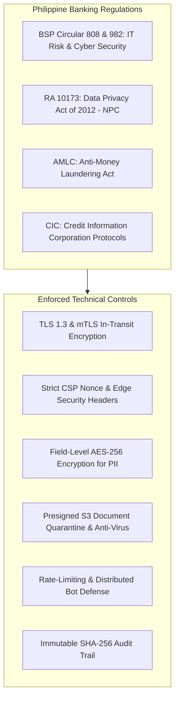
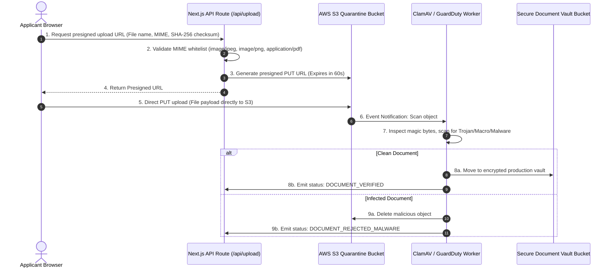

# Banking-Grade Security Architecture & Compliance Specifications
## Project: Sterling Bank of Asia – Digital Consumer Loan Platform
**Compliance Standards:** BSP Circular 808 / 982, RA 10173 (Data Privacy Act), OWASP Top 10 (2025/2026), PCI-DSS v4.0  
**Target Architecture:** Next.js 15+ (App Router) with Edge Middleware & Enterprise Banking Gateway  
**File Location:** `d:\Consumer Loan\security.md`  

---

## 1. Regulatory Compliance Framework (Philippines)

As a licensed thrift bank under the supervision of the **Bangko Sentral ng Pilipinas (BSP)**, the consumer loan digital platform must enforce non-negotiable security controls:



---

## 2. HTTP Security Headers & Edge Middleware Hardening

The Next.js application must emit hardened HTTP headers on every incoming request via `middleware.ts`.

### 2.1 Complete Production `middleware.ts` Specification:
```typescript
import { NextResponse } from 'next/server';
import type { NextRequest } from 'next/request';

export function middleware(request: NextRequest) {
  // 1. Generate cryptographic nonce for Content Security Policy
  const nonce = Buffer.from(crypto.randomUUID()).toString('base64');
  
  // 2. Strict Content Security Policy (CSP)
  const cspHeader = `
    default-src 'self';
    script-src 'self' 'nonce-${nonce}' 'strict-dynamic';
    style-src 'self' 'unsafe-inline' https://fonts.googleapis.com;
    img-src 'self' blob: data: https://*.sterlingbankasia.com https://s3.ap-southeast-1.amazonaws.com;
    font-src 'self' https://fonts.gstatic.com;
    connect-src 'self' https://api.sterlingbankasia.com https://*.upstash.io;
    frame-ancestors 'none';
    form-action 'self';
    base-uri 'self';
    object-src 'none';
    upgrade-insecure-requests;
  `.replace(/\s{2,}/g, ' ').trim();

  // Clone response headers
  const requestHeaders = new Headers(request.headers);
  requestHeaders.set('x-nonce', nonce);
  requestHeaders.set('Content-Security-Policy', cspHeader);

  const response = NextResponse.next({
    request: {
      headers: requestHeaders,
    },
  });

  // 3. Mandatory Banking Security Headers
  response.headers.set('Content-Security-Policy', cspHeader);
  response.headers.set('X-Frame-Options', 'DENY');
  response.headers.set('X-Content-Type-Options', 'nosniff');
  response.headers.set('Referrer-Policy', 'strict-origin-when-cross-origin');
  response.headers.set(
    'Strict-Transport-Security',
    'max-age=63072000; includeSubDomains; preload'
  );
  response.headers.set(
    'Permissions-Policy',
    'camera=(self), microphone=(), geolocation=(), browsing-topics=(), payment=()'
  );
  response.headers.set('Cross-Origin-Opener-Policy', 'same-origin');
  response.headers.set('Cross-Origin-Resource-Policy', 'same-origin');

  return response;
}

export const config = {
  matcher: [
    /*
     * Match all request paths except for:
     * - _next/static (static files)
     * - _next/image (image optimization files)
     * - favicon.ico (favicon file)
     */
    {
      source: '/((?!_next/static|_next/image|favicon.ico).*)',
      missing: [
        { type: 'header', key: 'next-router-prefetch' },
        { type: 'header', key: 'purpose', value: 'prefetch' },
      ],
    },
  ],
};
```

---

## 3. Data Protection & Encryption Architecture

### 3.1 Data in Transit
- **Public Traffic:** TLS 1.3 enforced at Cloudflare / Edge WAF. Fallback to TLS 1.2 with perfect forward secrecy (ECDHE-RSA-AES128-GCM-SHA256, ECDHE-ECDSA-AES256-GCM-SHA384).
- **Internal Microservices / Core Banking:** Mutual TLS (mTLS) with internal PKI certificates between Next.js server actions and the Loan Origination System (LOS).

### 3.2 Data at Rest & Field-Level Encryption (FLE)
Sensitive Personally Identifiable Information (PII) must never be stored as plaintext, even inside database columns:

| Field Name | Classification | Encryption Standard | Storage Treatment |
| :--- | :--- | :--- | :--- |
| **PhilSys ID / SSS / TIN** | High Risk PII | AES-256-GCM with Envelope Encryption (KMS) | Deterministic Hash for indexing + Ciphertext |
| **Gross Monthly Income** | Confidential Financial | AES-256-GCM | Encrypted payload |
| **Mother's Maiden Name** | Critical Security Question | Argon2id Hash / Salted | One-way irreversible verification hash |
| **Uploaded ID & Payslips** | High Risk Document | Server-side AWS S3 KMS (`aws:kms`) | Encrypted at rest, private bucket with no public read |

### Field-Level Encryption Implementation (`lib/encryption/crypto.ts`):
```typescript
import { createCipheriv, createDecipheriv, randomBytes } from 'crypto';

const ALGORITHM = 'aes-256-gcm';
const MASTER_KEY = Buffer.from(process.env.BANK_FIELD_ENCRYPTION_KEY || '', 'hex'); // 32 bytes

export function encryptPII(plainText: string): string {
  const iv = randomBytes(12); // 96-bit IV for AES-GCM
  const cipher = createCipheriv(ALGORITHM, MASTER_KEY, iv);
  
  let encrypted = cipher.update(plainText, 'utf8', 'hex');
  encrypted += cipher.final('hex');
  const authTag = cipher.getAuthTag().toString('hex');

  // Format: iv:authTag:encryptedCiphertext
  return `${iv.toString('hex')}:${authTag}:${encrypted}`;
}

export function decryptPII(cipherPayload: string): string {
  const [ivHex, authTagHex, encryptedText] = cipherPayload.split(':');
  if (!ivHex || !authTagHex || !encryptedText) {
    throw new Error('Invalid cipher payload structure');
  }

  const decipher = createDecipheriv(
    ALGORITHM,
    MASTER_KEY,
    Buffer.from(ivHex, 'hex')
  );
  decipher.setAuthTag(Buffer.from(authTagHex, 'hex'));

  let decrypted = decipher.update(encryptedText, 'hex', 'utf8');
  decrypted += decipher.final('utf8');
  return decrypted;
}
```

---

## 4. Secure Document Ingestion Pipeline (KYC File Uploads)

Direct file uploads to the application server create significant attack surfaces (RCE, buffer overflow, ZIP bomb, malware injection). Sterling Bank digital architecture enforces **Pre-signed S3 Ingestion with Quarantine**:



### Document Upload Rules:
1. **Magic Number Verification:** File extensions are strictly ignored; file headers are parsed to ensure true binary match:
   - `FF D8 FF` for JPEG
   - `89 50 4E 47` for PNG
   - `25 50 44 46` (`%PDF-`) for PDF
2. **Metadata Scrubbing:** Strip EXIF geo-tags and camera identifiers prior to archival to prevent location leakage.
3. **Storage Isolation:** File names are replaced with UUIDs (`f47ac10b-58cc-4372-a567-0e02b2c3d479.enc`), making file guessing and directory traversal impossible.

---

## 5. Rate Limiting, Anti-Bot & CSRF Defenses

### 5.1 Endpoint Rate Limiting (Token Bucket via Upstash Redis)
| Endpoint | Window | Max Requests | Action on Breach |
| :--- | :--- | :--- | :--- |
| `/api/otp/send` | 60 seconds | 2 per IP / Phone | HTTP 429 + 15 min lock |
| `/api/otp/verify` | 5 minutes | 5 attempts | Invalidate OTP + require fresh generation |
| `/api/loans/submit` | 10 minutes | 3 attempts | Require Cloudflare Turnstile verification |
| `/tracker` | 60 seconds | 10 lookups | CAPTCHA Challenge |

### 5.2 Server Action CSRF Protection
Next.js 15 App Router natively validates the `Origin` and `Host` request headers against the action URL to prevent Cross-Site Request Forgery (CSRF). In addition:
- Custom session tokens are signed with HMAC-SHA256.
- Idempotency Keys are generated for every loan submission to eliminate duplicate loan origination requests from accidental double clicks.

---

## 6. Audit Trail & Non-Repudiation Architecture

To comply with **BSP Circular 982** on forensic audit trails and legal non-repudiation:
1. Every loan submission generates an immutable JSON audit log:
```json
{
  "applicationId": "SBA-LN-202611-98421",
  "timestamp": "2026-11-04T12:54:33.102Z",
  "applicantIdHash": "e3b0c44298fc1c149afbf4c8996fb92427ae41e4649b934ca495991b7852b855",
  "ipAddress": "112.198.xxx.xxx",
  "clientUserAgent": "Mozilla/5.0 (iPhone; CPU iPhone OS 17_4 like Mac OS X)...",
  "eSignConsentAccepted": true,
  "privacyPolicyVersion": "RA10173-SBA-V3.2",
  "payloadSha256Checksum": "7d793037a0760186574b0282f2f435e70d63b463",
  "signatureBlock": {
    "signerType": "APPLICANT_OTP_VERIFIED",
    "otpSessionId": "sess_89f0a28b"
  }
}
```
2. The audit record is signed with the bank's internal private key and pushed to an append-only, tamper-evident log store (AWS CloudWatch / S3 Object Lock in Compliance Mode).
